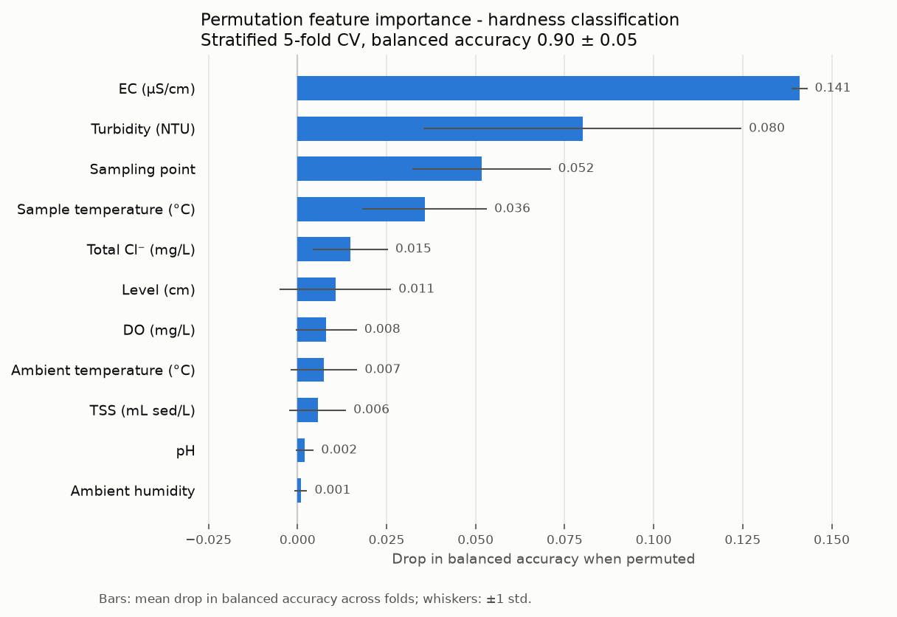

# Classificação da dureza da água de rio

## Contexto

- **Fonte:** [Kaggle – River Water Parameters](https://www.kaggle.com/datasets/natanaelferran/river-water-parameters/data).
- **Dados:** medições físico-químicas em 5 pontos de coleta, de 09/05/2023 a 28/11/2023.
- **Volume:** 219 amostras em 23 datas de coleta. Cada combinação de data, hora e ponto foi medida em duplicata.
- **Código:** `src/scripts/EDA.py` (exploração) e `src/scripts/model_pipeline.py` (modelo).

## Objetivo

Prever a classe de dureza (`hardness_classification`: **BLANDA** ou **SEMIDURA**) a partir dos parâmetros medidos no campo, sem usar a medição laboratorial da dureza.

## EDA descritiva

### Variável alvo

| Classe | Amostras | % | Faixa de dureza (mg CaCO₃/L) |
|---|---|---|---|
| SEMIDURA | 155 | 70,8 | 151 – 316 |
| BLANDA | 62 | 28,3 | 86 – 147 |
| Sem rótulo | 2 | 0,9 | — |

- As classes estão desbalanceadas, numa proporção de cerca de 2,5:1.
- A classe é um corte em torno de 150 mg CaCO₃/L. Por isso `hardness_(mg_caco3/l)` foi excluída das features: com ela, a balanced accuracy chega a 1,00 por vazamento de dados.

### Pontos de coleta

| Ponto | Amostras | BLANDA | SEMIDURA | Dureza mediana | EC mediana (µS/cm) |
|---|---|---|---|---|---|
| Arroyo Salguero | 42 | 2 | 40 | 234 | 1015 |
| Arroyo Las Torres | 44 | 6 | 38 | 208 | 1405 |
| Puente Bilbao | 45 | 26 | 17 | 135 | 1370 |
| Puente Falbo | 44 | 13 | 31 | 176 | 1370 |
| Puente Irigoyen | 44 | 15 | 29 | 176,5 | 1360 |

- Puente Bilbao é o único ponto em que BLANDA é a maioria.
- Os dois arroios são quase todos SEMIDURA.

### Variáveis numéricas

| Variável | Média | Desvio | Mín | Mediana | Máx | Ausentes |
|---|---|---|---|---|---|---|
| Temperatura ambiente (°C) | 17,6 | 5,2 | 10,4 | 17,0 | 30,5 | 0 |
| Umidade ambiente | 0,56 | 0,17 | 0,19 | 0,54 | 0,87 | 0 |
| Temperatura da amostra (°C) | 19,6 | 3,9 | 12,8 | 19,3 | 28,1 | 0 |
| pH | 8,03 | 0,29 | 7,2 | 8,1 | 8,7 | 0 |
| EC (µS/cm) | 1265 | 273 | 200 | 1330 | 1710 | 0 |
| TDS (mg/L) | 624 | 136 | 140 | 660 | 850 | 0 |
| TSS (mL sed/L) | 61,0 | 87,1 | 0,1 | 48,0 | 650 | 6 |
| OD (mg/L) | 2,62 | 1,96 | 0,0 | 1,87 | 9,12 | 0 |
| Nível (cm) | 38,3 | 12,5 | 10 | 35 | 70 | 39 |
| Turbidez (NTU) | 145 | 235 | 1,1 | 59,3 | 1000 | 1 |
| Dureza (mg CaCO₃/L) | 191 | 56 | 86 | 188 | 316 | 2 |
| Cl⁻ total (mg/L) | 103 | 33 | 15 | 109 | 174 | 6 |

Observações:

- **TDS:** é derivado do EC (TDS ≈ 0,49 × EC, r = 0,999). Foi excluído por ser redundante.
- **Variáveis da data de coleta:** temperatura ambiente, umidade e nível são constantes dentro de uma mesma data. Na prática, funcionam como identificadores da data.
- **Valores extremos:** a turbidez tem máximo de 1000 NTU, provavelmente o limite do sensor, e o TSS chega a 650.
- **Ausentes:** o nível concentra a maior parte (18%). Esses valores são imputados pela mediana, sem descartar linhas.

## Modelo

| Item | Configuração |
|---|---|
| Features | 10 numéricas + `sampling_point` (one-hot) |
| Excluídas | `hardness_(mg_caco3/l)` (origem do alvo), `tds_(mg/l)` (redundante), `date` (descartada na leitura), `time` |
| Pré-processamento | Imputação pela mediana dentro do `Pipeline`, ajustada em cada fold |
| Classificador | Random Forest: 300 árvores, `max_depth=5`, `class_weight='balanced'` |
| Validação | `StratifiedKFold` com 5 folds, embaralhado |
| Métrica | Balanced accuracy |
| **Resultado** | **0,901 ± 0,053** (folds de 0,820 a 0,968) |

- A data de coleta não é considerada pelo modelo.
- Ressalva: sem agrupamento, as duas medições de uma mesma coleta podem cair uma no treino e outra na validação, o que torna o score otimista.
- As 2 amostras sem rótulo (Puente Bilbao) foram previstas como SEMIDURA.

## Estratégia de feature importance

- **Método:** importância por permutação (`sklearn.inspection.permutation_importance`).
- **Cálculo:** em cada fold, cada feature é embaralhada no conjunto de validação e mede-se a queda na balanced accuracy. São 30 repetições por feature.
- **Agregação:** média e desvio padrão entre os 5 folds estratificados.
- **Por que permutação, e não a importância nativa da Random Forest (MDI):**
  - Mede o efeito em dados não vistos no treino.
  - Não favorece variáveis contínuas ou de alta cardinalidade.
  - Usa a mesma métrica da avaliação do modelo.
- **Ponto de coleta:** a coluna original é embaralhada antes do one-hot, então o ponto é avaliado como uma feature única.
- **Interpretação:** valores ≤ 0 indicam que a feature não contribui fora da amostra de treino.

| Feature | Importância (média ± desvio) |
|---|---|
| EC (µS/cm) | 0,141 ± 0,002 |
| Turbidez (NTU) | 0,080 ± 0,045 |
| Ponto de coleta | 0,052 ± 0,019 |
| Temperatura da amostra (°C) | 0,036 ± 0,017 |
| Cl⁻ total (mg/L) | 0,015 ± 0,011 |
| Demais (nível, OD, temperatura ambiente, TSS, pH, umidade) | entre 0,001 e 0,011 |

## Conclusão

- Sem a dureza medida, o modelo atinge balanced accuracy de 0,90 ± 0,05 em validação cruzada estratificada de 5 folds.
- O sinal vem principalmente da condutividade (EC), que é a feature mais importante e a mais estável entre os folds (desvio de 0,002). Em seguida vêm a turbidez, o ponto de coleta e a temperatura da amostra.
- Nível, OD, temperatura ambiente, TSS, pH e umidade têm contribuição marginal (≤ 0,011).
- **Próximos passos:**
  - Confirmar se o Cl⁻ total está disponível no momento da previsão, já que provavelmente é medido em laboratório.
  - Testar modelos mais simples, como regressão logística sobre EC e ponto de coleta.
